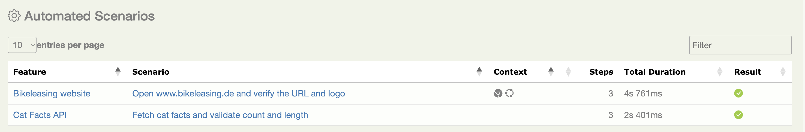

# Bikeleasing Serenity Kotlin PoC

This repository contains a small proof-of-concept test project built with Gradle, Kotlin, JUnit Jupiter, and Serenity BDD.

The project demonstrates two automated checks:

- a UI test that opens the Bikeleasing website and checks that the host is `bikeleasing.de`;
- an API test that requests cat facts from `catfact.ninja`, verifies the number of returned facts, and checks the reported length of the first fact.

## Tech Stack

- Gradle Wrapper
- Kotlin
- JUnit Jupiter
- Serenity BDD
- Serenity REST Assured
- Selenium/WebDriver managed by Serenity

## Project Structure

```text
features/
src/test/kotlin/api
src/test/kotlin/ui
src/test/resources/serenity.conf
.github/workflows/tests.yml
```

### API Tests

`src/test/kotlin/api/CatFactAPITests.kt` requests:

```text
https://catfact.ninja/facts?limit=5
```

The test checks three things:

- the response status is `200`;
- `data` contains five facts;
- `length` on the first fact equals the length of its `fact` text.

`api.base.url` and `api.facts.path` come from `serenity.conf`.

### UI Tests

`src/test/kotlin/ui/BikeleasingUITests.kt` opens `web.base.url` and compares the browser host with `web.expected.host`. These are two separate settings. A redirect may change the scheme or drop `www`.

Default values:

```text
web.base.url = https://www.bikeleasing.de
web.expected.host = bikeleasing.de
```

Serenity starts Chrome. Headless mode is set in `src/test/resources/serenity.conf`.

One extra step looks for the header image with alt text `Bikeleasing Logo`. The assignment does not ask for that check.

### Feature Files

`features/` describes theft, damage, and defect or wear. Comments mark assumptions. The same notes and the open questions are in [features/assumptions.md](features/assumptions.md). The Gradle test task does not execute these files.

## Configuration

Website settings live in `src/test/resources/serenity.conf`:

```hocon
web.base.url = "https://www.bikeleasing.de"
web.expected.host = "bikeleasing.de"

webdriver {
  driver = chrome
  capabilities {
    browserName = "chrome"
  }
}

headless.mode = true
chrome.switches = """--headless=new;--disable-gpu;--window-size=1920,1080;--no-sandbox"""
```

`web.base.url` can be overridden with `WEB_BASE_URL`. `web.expected.host` can be overridden with `WEB_EXPECTED_HOST`. Changing only the opened URL does not change the host the test expects.

## Running Tests

Run all tests. The Serenity report is built at the end of the test task:

```bash
./gradlew test
```

Run one class:

```bash
./gradlew test --tests ui.BikeleasingUITests
./gradlew test --tests api.CatFactAPITests
```

## Serenity Report

After the tests, the report is at:

```text
target/site/serenity/index.html
```

`target/` is gitignored. The HTML is produced by the test run. Both checks in one local run:



## GitHub Actions

`.github/workflows/tests.yml` runs on a push, a pull request, or a manual run from the Actions tab. The job installs Temurin 25 and Chrome, runs `./gradlew test --no-daemon`, and uploads the Serenity report. The report is uploaded even when a test fails.

## Requirements

- Java 25
- Chrome for the UI test

Run the tests with `./gradlew`. A separate Gradle install is not required.

## Agent skills

`.github/skills/` holds instructions for a coding agent. CI does not execute them.

- `serenity-web`: add or change a web test
- `serenity-api`: add or change an API test
- `ui-test-review`: review a web test against a requirement you point to
- `api-test-review`: review an API test against a requirement you point to
- `feature-authoring`: write feature files from a requirement or diagram you point to
- `bdd-review`: review feature files against requirements you point to
